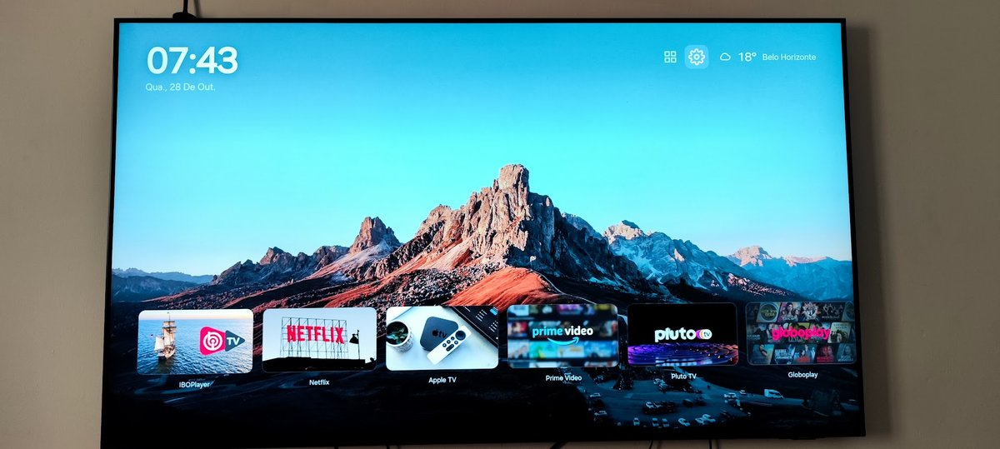
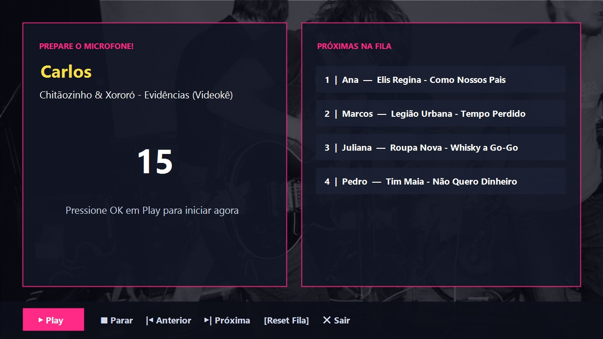
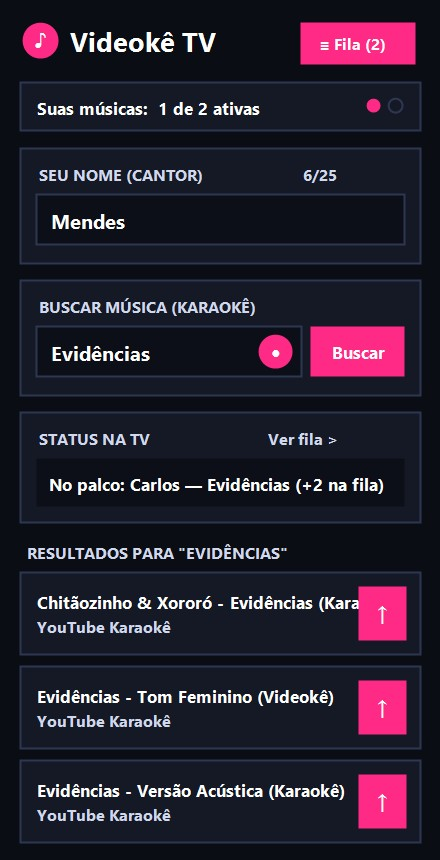

# lilauncher

Um launcher minimalista e original para Smart TVs Samsung com Tizen, empacotado como um aplicativo web instalado por sideload. Foi construído e testado em uma Samsung UN65BU8000 (Tizen 6.5, 2022) e deve funcionar na família BU e AU 8000 e em modelos Tizen 6.x próximos.

A proposta é uma tela inicial limpa: uma única fileira com as capas dos seus aplicativos, relógio, clima com busca de cidade, protetor de tela com rotação de fotos, tema claro, escuro e automático, uma visão de todos os aplicativos instalados e um atalho para as configurações da TV.

> Este projeto não tem qualquer vínculo com a Samsung. É um trabalho pessoal, compartilhado para quem quiser usar na própria TV ou se basear para criar o seu.

## O que ele faz

A fileira principal mostra os aplicativos que você escolher, na ordem que definir, com capas no formato paisagem. No alto ficam o relógio, a data, e o clima da sua cidade, obtido do Open-Meteo sem necessidade de chave de API. À direita há dois ícones: todos os aplicativos e as configurações do launcher.

Dentro das configurações você ajusta o tema, a cidade do clima (com busca por nome, que converte para coordenadas pela internet), o papel de parede, o tempo do protetor de tela e abre as configurações nativas da TV. O protetor de tela entra após um tempo ocioso e faz uma rotação suave entre os papéis de parede, com relógio sobreposto.

## Limitações honestas

A tecla Home física da TV não pode ser remapeada para este launcher sem root nesta geração de firmware. O lilauncher é um aplicativo instalado por sideload, que você abre pela lista de aplicativos. Para aproximar o efeito de abrir no boot, dá para usar o recurso nativo da TV chamado Executar automaticamente o último aplicativo, deixando o launcher como o último aberto antes de desligar.

## Requisitos

1. Tizen Studio com a linha de comando instalada.
2. Um certificado Samsung (autor e distribuidor) vinculado ao DUID da sua TV. É gratuito e as ferramentas da Samsung guiam a criação.
3. Modo de desenvolvedor ativo na TV.
4. Um PC na mesma rede da TV. Os scripts prontos são para Windows, mas os comandos por baixo são o Tizen CLI padrão e se adaptam a Mac e Linux.

## Como instalar

1. Ative o modo de desenvolvedor na TV e informe o IP do seu PC.
2. Crie o certificado Samsung e registre o perfil no Tizen CLI.
3. Ajuste, se necessário, o IP da TV e o nome do perfil dentro de scripts/instalar-launcher.ps1, ou passe como parâmetros.
4. Rode scripts/instalar-launcher.bat. Ele monta o pacote a partir de src/, assina com o seu perfil e instala na TV via sdb.

Para remover, use scripts/remover-launcher.bat.

## Como personalizar

Aplicativos e ordem ficam em src/js/data/shelf.js. Cada item usa o ID real do aplicativo na sua TV. Para descobrir os IDs, com o modo de desenvolvedor ativo e a TV conectada, você pode usar o comando sdb shell 0 vd_applist.

A cidade do clima é definida dentro do próprio launcher, em Configurações, Cidade do clima.

Os papéis de parede ficam em src/img/wallpapers. Depois de trocar as imagens, rode scripts/scan-walls.mjs para regenerar o arquivo src/js/data/walls.js.

O ícone do aplicativo é src/icon.png, um PNG quadrado de 512 por 512.

## Sobre as imagens

Os papéis de parede e o ícone do aplicativo são fotos pessoais do autor, incluídas apenas como exemplo. Uma das imagens, src/img/wallpapers/nos_01.jpg, foi deixada de fora do repositório de propósito, por ser pessoal. Se você clonar o projeto, troque essas imagens pelas suas; é só colocar as suas fotos na pasta de wallpapers e rodar o scan-walls.mjs, e substituir o icon.png.

## Aplicativo Integrado: Videokê TV (`lilvideoke.Videoke`)

O **lilauncher** inclui em sua fileira principal o atalho para o **Videokê TV**, uma estação de karaokê/videokê desenvolvida especificamente para a Smart TV Samsung Tizen 6.5 com controle de fila em tempo real pelo celular via QR Code:

- **Repositório dedicado do Videokê TV**: [https://github.com/mendes79/videoke-tv](https://github.com/mendes79/videoke-tv)
- **Web App Mobile (Controle de Fila)**: [https://videoke-tv.web.app](https://videoke-tv.web.app)

### Destaques do Videokê TV
- **Pareamento instantâneo por QR Code**: Convidados escaneiam o QR Code na tela da TV (ou o Mini QR Code exibido no canto inferior esquerdo durante as músicas) sem precisar instalar nada no celular.
- **Busca por texto e comando de voz (YouTube Data API v3)**: Interface mobile de alta visibilidade (conforto visual 40+) com busca rápida por voz, limite de 2 músicas ativas por participante, visualização da fila em tempo real e opção de cancelar músicas pendentes.
- **Transição automática de 15 segundos em 2 colunas**: Mostra à esquerda o próximo cantor e a contagem regressiva, e à direita a lista numerada das próximas músicas da fila sobre 13 papéis de parede em Full HD sorteados aleatoriamente.
- **Controles completos na TV**: Barra de rodapé com botão dinâmico `Play`/`Pausa` (timeout automático de 60 segundos em pausa com aviso sonoro nos 10s finais), `Parar`, `Anterior`, `Próxima`, `Reset Fila` e `Sair`.

| Tela de Contagem e Fila na TV (1080p) | App Mobile de Seleção e Fila (Alta Visibilidade) |
| :---: | :---: |
|  |  |

## Licença

MIT. Veja o arquivo LICENSE. Use, modifique e compartilhe à vontade.
