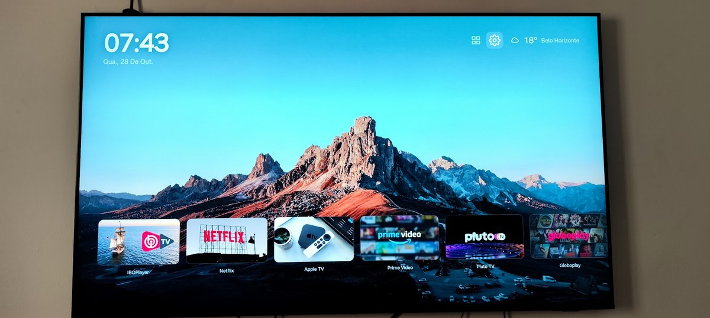
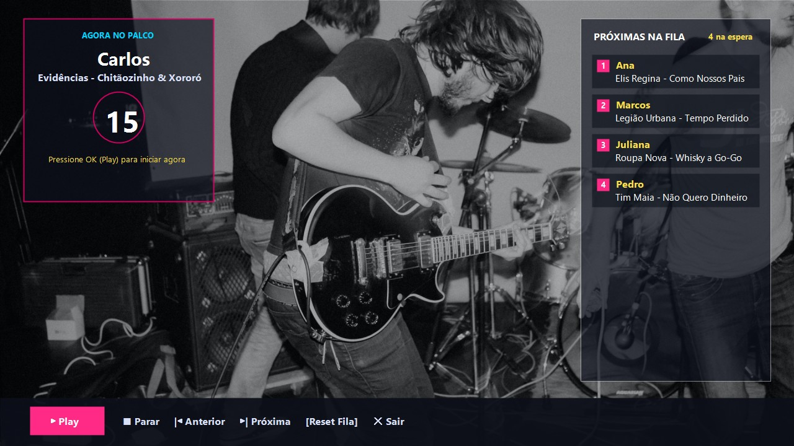
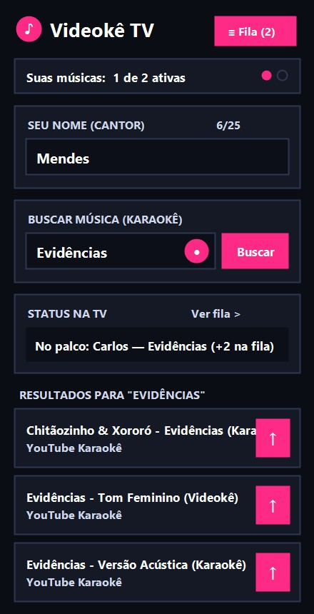

# 📺 lilauncher — Tela inicial minimalista para Smart TV Samsung (Tizen)

-555)

> **EN:** A clean, minimalist custom home screen (launcher) for Samsung Smart TVs running Tizen, sideloaded as a `.wgt` web app. One row of app covers, clock, weather, photo screensaver, light/dark themes.

Um launcher minimalista e original para Smart TVs Samsung com Tizen, empacotado como um aplicativo web instalado por **sideload**. Foi construído e testado em uma **Samsung UN65BU8000 (Tizen 6.5, 2022)** e deve funcionar na família BU e AU 8000 e em modelos Tizen 6.x próximos.

A proposta é uma tela inicial limpa: uma única fileira com as capas dos seus aplicativos, relógio, clima com busca de cidade, protetor de tela com rotação de fotos, tema claro, escuro e automático, uma visão de todos os aplicativos instalados e um atalho para as configurações da TV.

> Este projeto não tem qualquer vínculo com a Samsung. É um trabalho pessoal, compartilhado para quem quiser usar na própria TV ou se basear para criar o seu.

## ▶️ Demonstração

<!-- TODO: cole aqui o link do vídeo de demonstração no YouTube. Ex.: [Ver demo](https://youtu.be/SEU_VIDEO) -->
_Vídeo de demonstração em breve._

## O que ele faz

A fileira principal mostra os aplicativos que você escolher, na ordem que definir, com capas no formato paisagem. No alto ficam o relógio, a data, e o clima da sua cidade, obtido do Open-Meteo sem necessidade de chave de API. À direita há dois ícones: todos os aplicativos e as configurações do launcher.

Dentro das configurações você ajusta o tema, a cidade do clima (com busca por nome, que converte para coordenadas pela internet), o papel de parede, o tempo do protetor de tela e abre as configurações nativas da TV. O protetor de tela entra após um tempo ocioso e faz uma rotação suave entre os papéis de parede, com relógio sobreposto.

## Limitações honestas

A tecla Home física da TV não pode ser remapeada para este launcher sem root nesta geração de firmware. O lilauncher é um aplicativo instalado por sideload, que você abre pela lista de aplicativos. Para aproximar o efeito de abrir no boot, dá para usar o recurso nativo da TV chamado Executar automaticamente o último aplicativo, deixando o launcher como o último aberto antes de desligar.

## Requisitos

1. Tizen Studio com a linha de comando instalada.
2. Um certificado Samsung (autor e distribuidor) vinculado ao DUID da sua TV. É gratuito e as ferramentas da Samsung guiam a criação.
3. Modo de desenvolvedor ativo na TV.
4. Um PC na mesma rede da TV. Os scripts prontos são para Windows, mas os comandos por baixo são o Tizen CLI padrão e se adaptam a Mac e Linux.

## Como instalar

1. Ative o modo de desenvolvedor na TV e informe o IP do seu PC.
2. Crie o certificado Samsung e registre o perfil no Tizen CLI.
3. Ajuste, se necessário, o IP da TV e o nome do perfil dentro de scripts/instalar-launcher.ps1, ou passe como parâmetros.
4. Rode scripts/instalar-launcher.bat. Ele monta o pacote a partir de src/, assina com o seu perfil e instala na TV via sdb.

Para remover, use scripts/remover-launcher.bat.

## Como personalizar

Aplicativos e ordem ficam em src/js/data/shelf.js. Cada item usa o ID real do aplicativo na sua TV. Para descobrir os IDs, com o modo de desenvolvedor ativo e a TV conectada, você pode usar o comando sdb shell 0 vd_applist.

A cidade do clima é definida dentro do próprio launcher, em Configurações, Cidade do clima.

Os papéis de parede ficam em src/img/wallpapers. Depois de trocar as imagens, rode scripts/scan-walls.mjs para regenerar o arquivo src/js/data/walls.js.

O ícone do aplicativo é src/icon.png, um PNG quadrado de 512 por 512.

## Sobre as imagens

Os papéis de parede e o ícone do aplicativo são fotos pessoais do autor, incluídas apenas como exemplo. Uma das imagens, src/img/wallpapers/nos_01.jpg, foi deixada de fora do repositório de propósito, por ser pessoal. Se você clonar o projeto, troque essas imagens pelas suas; é só colocar as suas fotos na pasta de wallpapers e rodar o scan-walls.mjs, e substituir o icon.png.

## Ecossistema (apps que rodam no lilauncher)

O lilauncher é a casa de alguns aplicativos dedicados para a mesma TV:

- 🎮 **[SNES Tizen Emulator](https://github.com/mendes79/SNES-Tizen-Emulator)** — emulador de Super Nintendo (núcleo snes9x2005 em WebAssembly).
- 🕹️ **[Atari 2600 Tizen Emulator](https://github.com/mendes79/Atari-2600-Tizen-Emulator)** — emulador de Atari 2600 (núcleo Stella 2014 em WebAssembly).
- 🎮 **[NES Tizen Emulator](https://github.com/mendes79/NES-Tizen-Emulator)** — emulador de NES (núcleo FCEUmm em WebAssembly).
- 🎤 **[Videokê TV](https://github.com/mendes79/videoke-tv)** — estação de karaokê com fila em tempo real pelo celular via QR Code.

### Videokê TV (`lilvideoke.Videoke`)

Estação de karaokê/videokê para a Smart TV Samsung Tizen 6.5 com controle de fila em tempo real pelo celular via QR Code.

- Pareamento instantâneo por QR Code, sem instalar nada no celular.
- Busca por texto e voz (YouTube Data API v3), com limite de 2 músicas ativas por participante.
- Transição automática mostrando próximo cantor e fila sobre papéis de parede em Full HD.
- Controles completos na TV (Play/Pausa, Parar, Anterior, Próxima, Reset Fila, Sair).
- Web App Mobile: [https://videoke-tv.web.app](https://videoke-tv.web.app)

| Contagem e fila na TV (1080p) | App Mobile (alta visibilidade) |
| :---: | :---: |
|  |  |

## Licença

MIT. Veja o arquivo LICENSE. Use, modifique e compartilhe à vontade.
